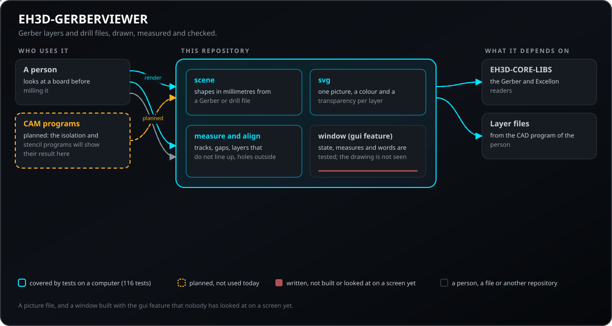
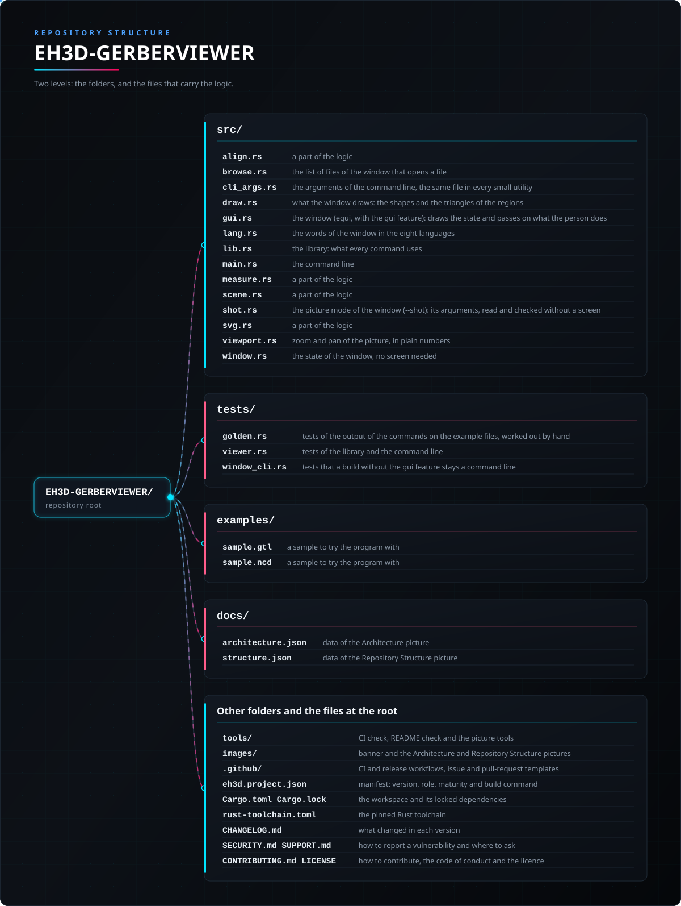

<p align="center">
  
</p>

#  EH3D-GERBERVIEWER
<p align="center">🇺🇸 <b>English</b> | <a href="README_spa.md">🇪🇸 Español</a> | <a href="README_fra.md">🇫🇷 Français</a> | <a href="README_ita.md">🇮🇹 Italiano</a> | <a href="README_deu.md">🇩🇪 Deutsch</a> | <a href="README_zho.md">🇨🇳 中文</a> | <a href="README_jpn.md">🇯🇵 日本語</a> | <a href="README_por.md">🇵🇹 Português</a></p>

### A light viewer of Gerber layers and drill files: pictures, measures and alignment checks

<p align="center">
  
  
  
  
  
</p>

---

**Honesty check - what actually runs today:** a Rust library and a command line program (`eh3d-gerberview`) with 119 tests that run on a computer: draws Gerber layers and drill files as an SVG picture, measures tracks and gaps and checks that the layers line up. It has a window (built with `--features gui`) that shows the layers one over the other with zoom and panning, but the window has not been looked at on a screen yet; it has not been tried on a machine and it has not been checked against a collection of real files.

---

> **Safety and security status:** this program does not control any machine and is not a safety system. What it produces must be checked by a person before anything is run on a machine; nothing here has run on real hardware.


## 📋 At a glance

| | |
|---|---|
| Version | `0.0.6` |
| Maturity | Scaffolding |
| Tests | 119 |
| Stack | Rust |
| On real hardware | Not tried: nothing here has run on a machine |

**Jump to:** [Overview](#-overview) · [Architecture](#-architecture) · [Quick start](#-quick-start) · [Testing](#-testing) · [Structure](#-repository-structure) · [Related](#-related-projects)

## 🚦 Project status

Each line is one part of this repository and the light says how far it is today. It is written from what the repository can show (tests, builds, runs), not from what is planned.

🟢 Done and verified · 🟡 Works, with known limits · 🟠 Partly done or not verified yet · 🔴 Not done or not working

| Area | State | What it means here |
|---|---|---|
| Core | 🟡 | draws Gerber layers and drill files as an SVG picture, measures tracks and gaps and checks that the layers line up; tested on a computer with normal and damaged input, not with a collection of real files. |
| Command line | 🟡 | `eh3d-gerberview` runs the same functions as the library and prints the result; every error comes back as a message and a non-zero exit code. |
| Tests | 🟡 | 119 tests pass (`cargo test`), with normal cases, edge cases and damaged input. |
| Security | 🟡 | Plain safe Rust (`forbid(unsafe_code)`): nothing panics on the files it is given and a bad value is an error with its reason; no independent review. |
| Window | 🟠 | Written (egui, `--features gui`): add or drop several layers and drill files, show or hide each, zoom and pan, measure, check the alignment, export the picture as SVG; its logic is tested, but it has not been built or looked at on a screen yet. |
| Real hardware | 🔴 | Not tried: nothing here has been run on a machine. |
| Documentation | 🟡 | README in eight languages, the changelog and the two pictures drawn from `docs/`. |

## 🎯 Overview

* **The shapes** (`src/scene.rs`, `eh3d-geometry`): pads (round, rectangular, obround), tracks with their width, regions and arcs, all in millimetres whatever the units of the file; the holes of a drill file become discs of the diameter of their tool. What cannot be drawn exactly (clear polarity, step and repeat, macro apertures) is listed, once each. A track drawn with a rectangular pen is the swept rectangle (the segment and the pen, a polygon), not a line with round ends.
* **The picture** (`src/svg.rs`): every layer is a group with its own colour (from the extension of the file) and transparency, the board seen from above with y up; an empty list of layers gives a small empty picture, and names and colours are escaped and checked.
* **Measures and checks** (`src/measure.rs`, `src/align.rs`): the narrowest track, the distance between two pads, the smallest gap between round pads and tracks (edge to edge, 0 where they touch), the layers whose centre is off, and the holes that are not inside the copper. `check` says when there are no layers to compare instead of claiming that they line up, and `measure` takes exactly one layer. Every command also takes `--max-bytes N` (a larger file is refused before it is read, with the message in the language of the system) and `--arc-tolerance MM` (how closely arcs are followed).

## 🧩 Role in EH3D

EH3D-GERBERVIEWER is one program of the EH3D Fabrication Suite. It works as a library and a command line and, built with `--features gui`, as a window in the look the other programs of the suite share. It reads and writes plain files, so it can be used on its own or between the other programs.

## 🏛️ Architecture

<p align="center">
  
</p>


How the parts of this repository fit together: who uses it, what it holds and what it depends on. The picture is drawn from `docs/architecture.json` and checked against the code.

## ✨ Features

* **A library and a command line:** every command of `eh3d-gerberview` is a function of the library, so another program of the suite can call it without starting a process.
* **Tests with damaged input:** the tests also feed empty files, garbage, huge numbers and cut files, and none of them may panic.
* **No guessing:** a value that does not make sense is an error that says which value and why, never a result that only looks right.
* **No unsafe code:** `#![forbid(unsafe_code)]` in the library and the program.
* **A drill file is told by its header, and the layers are checked against public files:** a file that starts with `M48` is read as a drill file whatever its extension is (`.txt`, `.nc`, none), `check` compares only the centres of the layers (so a solder mask bigger than the copper lines up), and a test draws the public Gerber files of the readers inside the box their summaries expect.

## 🔒 Security & Safety

| Threat | Defense |
|---|---|
| A damaged, truncated or empty file | no panic: the tests cut valid input at every position and feed garbage |
| A number that makes no sense (negative, not finite, absurdly large) | refused with an error that names the value; nothing is rounded into something plausible |
| Unsafe memory use | plain safe Rust with `forbid(unsafe_code)` |

**What is not defended:** a result that was produced cleanly is not a verified result. Nothing here knows the limits of a machine, and the program has had no independent review. Report a vulnerability privately (see [SECURITY.md](SECURITY.md)).

## 🔌 Interfaces

The library is `eh3d_gerberviewer` (`use eh3d_gerberviewer::...`); the command line is `eh3d-gerberview`. The commands are these; each prints its result on the standard output and reports an error on the standard error with a non-zero exit code. There is no network access.

```text
EH3D-GERBERVIEWER/
├── src/
│   ├── align.rs                                 a part of the logic
│   ├── browse.rs                                the list of files of the window that opens a file
│   ├── draw.rs                                  what the window draws: the shapes and the triangles of the regions
│   ├── gui.rs                                   the window (egui, with the gui feature): draws the state and passes on what the person does
│   ├── lang.rs                                  the words of the window in the eight languages
│   ├── lib.rs                                   the library: what every command uses
│   ├── main.rs                                  the command line
│   ├── measure.rs                               a part of the logic
│   ├── scene.rs                                 a part of the logic
│   ├── shot.rs                                  the picture mode of the window (--shot): its arguments, read and checked without a screen
│   ├── svg.rs                                   a part of the logic
│   ├── viewport.rs                              zoom and pan of the picture, in plain numbers
│   └── window.rs                                the state of the window, no screen needed
├── tests/
│   ├── golden.rs                                tests of the output of the commands on the example files, worked out by hand
│   ├── viewer.rs                                tests of the library and the command line
│   └── window_cli.rs                            tests that a build without the gui feature stays a command line
├── examples/
│   ├── sample.gtl                               a sample to try the program with
│   └── sample.ncd                               a sample to try the program with
├── docs/
│   ├── architecture.json                        data of the Architecture picture
│   └── structure.json                           data of the Repository Structure picture
├── tools/                                       CI check, README check and the picture tools
├── images/                                      banner and the Architecture and Repository Structure pictures
├── .github/                                     CI and release workflows, issue and pull-request templates
├── eh3d.project.json                            manifest: version, role, maturity and build command
├── Cargo.toml Cargo.lock                        the workspace and its locked dependencies
├── rust-toolchain.toml                          the pinned Rust toolchain
├── CHANGELOG.md                                 what changed in each version
├── SECURITY.md SUPPORT.md                       how to report a vulnerability and where to ask
└── CONTRIBUTING.md CODE_OF_CONDUCT.md LICENSE   how to contribute, the code of conduct and the licence
```

## ⚙️ Configuration

There is no configuration file yet: what a person chooses is given as arguments of the command line (see Interfaces) and every default is written in the help of the command (`eh3d-gerberview help`). The fixed limits live in the code as named constants and are covered by tests.

## 🚀 Quick start

You need a stable Rust toolchain (1.75 or newer).

```bash
cargo build --release
cargo test
cargo run --release -- info examples/sample.gtl examples/sample.ncd
cargo run --release --features gui   # the window
cargo run --release --features gui -- --shot screen.png examples/sample.gtl   # a picture of the window
```

To take a picture of the window without opening it by hand, run it with `--shot FILE.png` (also `--size WxH`, `--theme forge|dark|light`, `--wait N`, `--lang CODE`, `--open FILE`, `--replace`): it opens at that size, saves the PNG, keeps no settings and closes by itself (exit code 0 when the file was written, 1 when it was not, 2 for wrong arguments).

## 🧪 Testing

The suite has 119 tests (`cargo test`, run on Windows and Linux in the CI). They check the normal cases, the edge cases and damaged input: empty files, garbage and cut files never panic. The CI also runs `cargo fmt --check`, `cargo clippy` with warnings as errors and `python -I tools/ci_validate.py`.

## 🏗️ Build & Release

The version lives in `Cargo.toml` and in `eh3d.project.json`; each version has its entry in [CHANGELOG.md](CHANGELOG.md). `build.bat` / `build.sh` build the program, `test.bat` / `test.sh` run the tests and `run.bat` / `run.sh` run it with a sample. Releases are published on GitHub.

### Downloads

Each release has the program with its window for Windows (64 and 32 bits), Linux (64 bits) and macOS (Apple silicon and Intel), as `<name>-<version>-<system>.zip` (Windows) or `.tar.gz` with the program, the licence, the readme, the icon and the examples. The files are built by GitHub Actions, listed in `SHA256SUMS` and signed with the EH3D key. To check a download, compare its hash with the `.sha256` file next to it (`sha256sum -c`) and check its signature with the `.sig` file next to it (`ssh-keygen -Y verify`).

## 📂 Repository Structure

<p align="center">
  
</p>

<details>
<summary>Text version of the tree</summary>

```text
EH3D-GERBERVIEWER/
├── src/
│   ├── align.rs                                 a part of the logic
│   ├── browse.rs                                the list of files of the window that opens a file
│   ├── draw.rs                                  what the window draws: the shapes and the triangles of the regions
│   ├── gui.rs                                   the window (egui, with the gui feature): draws the state and passes on what the person does
│   ├── lang.rs                                  the words of the window in the eight languages
│   ├── lib.rs                                   the library: what every command uses
│   ├── main.rs                                  the command line
│   ├── measure.rs                               a part of the logic
│   ├── scene.rs                                 a part of the logic
│   ├── shot.rs                                  the picture mode of the window (--shot): its arguments, read and checked without a screen
│   ├── svg.rs                                   a part of the logic
│   ├── viewport.rs                              zoom and pan of the picture, in plain numbers
│   └── window.rs                                the state of the window, no screen needed
├── tests/
│   ├── golden.rs                                tests of the output of the commands on the example files, worked out by hand
│   ├── viewer.rs                                tests of the library and the command line
│   └── window_cli.rs                            tests that a build without the gui feature stays a command line
├── examples/
│   ├── sample.gtl                               a sample to try the program with
│   └── sample.ncd                               a sample to try the program with
├── docs/
│   ├── architecture.json                        data of the Architecture picture
│   └── structure.json                           data of the Repository Structure picture
├── tools/                                       CI check, README check and the picture tools
├── images/                                      banner and the Architecture and Repository Structure pictures
├── .github/                                     CI and release workflows, issue and pull-request templates
├── eh3d.project.json                            manifest: version, role, maturity and build command
├── Cargo.toml Cargo.lock                        the workspace and its locked dependencies
├── rust-toolchain.toml                          the pinned Rust toolchain
├── CHANGELOG.md                                 what changed in each version
├── SECURITY.md SUPPORT.md                       how to report a vulnerability and where to ask
└── CONTRIBUTING.md CODE_OF_CONDUCT.md LICENSE   how to contribute, the code of conduct and the licence
```

</details>

## 🗺️ Roadmap & Known limits

**Known limits today**

* The window has not been looked at on a screen yet.
* It has not been tried on a machine nor with a collection of real files, and it has had no independent review.
* It does not compare rectangular pads or regions when it measures gaps, and the window draws the overlapping shapes of one layer one over the other, so the opacity adds up where they meet.

**Next**

* Look at the window on a screen and finish it: measuring by clicking on the picture, with the pads and tracks that a measure names highlighted.
* Draw each layer with its opacity as a whole, so that it does not add up where the shapes of one layer overlap.
* Try it with real files and with the other programs of the suite.

## 🌍 Languages

README and texts exist in English, Spanish, French, Italian, German, Chinese, Japanese and European Portuguese.

## 🔗 Related Projects

* [EH3D-CORE-LIBS](https://github.com/JuanenRac/EH3D-CORE-LIBS): the readers of Gerber, Excellon and G-code
* [EH3D-COMMON](https://github.com/JuanenRac/EH3D-COMMON): the project container and the shared types of the suite
* [EH3D-SUITE-LAUNCHER](https://github.com/JuanenRac/EH3D-SUITE-LAUNCHER): the hub that finds and starts the programs of the suite
* [EH3D-ISOCAM](https://github.com/JuanenRac/EH3D-ISOCAM): isolation milling of copper
* [EH3D-STENCILCAM](https://github.com/JuanenRac/EH3D-STENCILCAM): solder paste stencils

## 📚 Documentation

* [Changelog](CHANGELOG.md)
* [Architecture and structure data](docs/architecture.json): the data the two pictures are drawn from.

## 🤝 Contributing & Community

* Before a pull request run `cargo fmt --check`, `cargo clippy --all-targets -- -D warnings`, `cargo test` and `python -I tools/ci_validate.py`: all must pass. See [CONTRIBUTING.md](CONTRIBUTING.md) and the [code of conduct](CODE_OF_CONDUCT.md).
* The README exists in eight languages: a change to the text is made in all eight files, and the two pictures are drawn from `docs/architecture.json` and `docs/structure.json` by `tools/make_architecture.py` and `tools/make_structure.py`.
* Report a vulnerability privately: [SECURITY.md](SECURITY.md). Questions, ideas and reports: electrohobby3d@gmail.com ([SUPPORT.md](SUPPORT.md)).

## 👤 AUTHOR

**JuanenRac (Electro Hobby 3D)** · electrohobby3d@gmail.com

## 📜 LICENSE

Software: GPL-3.0-or-later. See [LICENSE](LICENSE). Hardware designs of the suite use CERN OHL-S.
