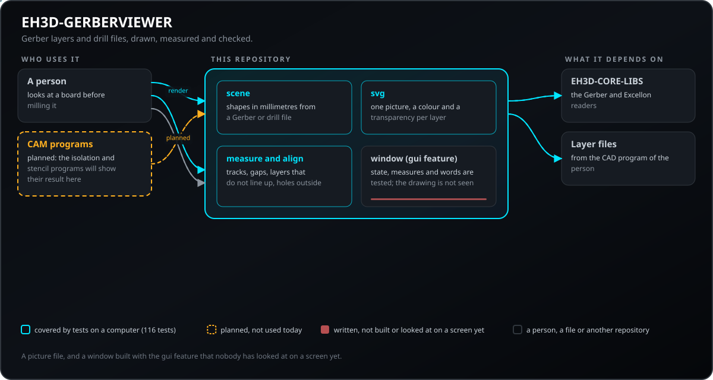
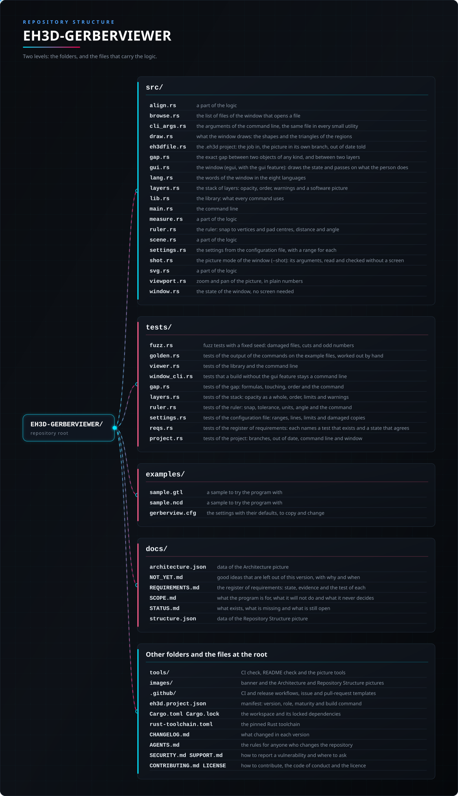

<p align="center">
  
</p>

#  EH3D-GERBERVIEWER
<p align="center"><a href="README.md">🇺🇸 English</a> | <a href="README_spa.md">🇪🇸 Español</a> | <a href="README_fra.md">🇫🇷 Français</a> | <a href="README_ita.md">🇮🇹 Italiano</a> | 🇩🇪 <b>Deutsch</b> | <a href="README_zho.md">🇨🇳 中文</a> | <a href="README_jpn.md">🇯🇵 日本語</a> | <a href="README_por.md">🇵🇹 Português</a></p>

### Ein leichter Betrachter für Gerber-Lagen und Bohrdateien: Bilder, Messungen und Ausrichtungsprüfung

<p align="center">
  
  
  
  
  
</p>

---

**Ehrlichkeitscheck - was heute wirklich läuft:** eine Rust-Bibliothek und ein Kommandozeilenprogramm (`eh3d-gerberview`) mit 243 Tests, die auf einem Computer laufen: zeichnet Gerber-Lagen und Bohrdateien als SVG-Bild, misst Leiterbahnen und Abstände und prüft, ob die Lagen zueinander passen. Es hat ein Fenster (Build mit `--features gui`), das die Ebenen übereinander mit Zoom und Verschieben zeigt, das aber noch auf keinem Bildschirm angesehen wurde; es wurde an keiner Maschine ausprobiert und nicht an einer Sammlung echter Dateien geprüft.

---

> **Sicherheitsstatus:** Dieses Programm steuert keine Maschine und ist kein Sicherheitssystem. Was es erzeugt, muss ein Mensch prüfen, bevor etwas an einer Maschine läuft; nichts davon lief auf echter Hardware.


## 📋 Auf einen Blick

| | |
|---|---|
| Version | `0.1.0` |
| Reifegrad | Funktionsfähig |
| Tests | 243 |
| Technologie-Stack | Rust |
| Auf echter Hardware | Nicht erprobt: nichts davon lief an einer Maschine |

**Springe zu:** [Überblick](#-überblick) · [Architektur](#-architektur) · [Schnellstart](#-schnellstart) · [Tests](#-tests) · [Struktur](#-struktur-des-repositorys) · [Verwandte](#-verwandte-projekte)

## 🚦 Projektstatus

Jede Zeile ist ein Teil dieses Repositorys, und die Ampel sagt, wie weit er heute ist. Sie beruht auf dem, was das Repository zeigen kann (Tests, Builds, Läufe), nicht auf dem, was geplant ist.

🟢 Fertig und überprüft · 🟡 Funktioniert, mit bekannten Grenzen · 🟠 Teilweise fertig oder noch nicht überprüft · 🔴 Nicht gemacht oder funktioniert nicht

| Bereich | Stand | Was das hier bedeutet |
|---|---|---|
| Kern | 🟡 | zeichnet Gerber-Lagen und Bohrdateien als SVG-Bild, misst Leiterbahnen und Abstände und prüft, ob die Lagen zueinander passen; am Computer mit normalen und beschädigten Eingaben getestet, nicht mit einer Sammlung echter Dateien. |
| Kommandozeile | 🟡 | `eh3d-gerberview` führt dieselben Funktionen wie die Bibliothek aus und gibt das Ergebnis aus; jeder Fehler kommt als Meldung mit einem Exit-Code ungleich null zurück. |
| Tests | 🟡 | 243 Tests bestehen (`cargo test`), mit Normalfällen, Grenzfällen und beschädigten Eingaben. |
| Sicherheit | 🟡 | Reines sicheres Rust (`forbid(unsafe_code)`): nichts gerät bei den übergebenen Dateien in Panik und ein schlechter Wert ist ein Fehler mit Begründung; keine unabhängige Prüfung. |
| Fenster | 🟠 | Geschrieben (egui, `--features gui`): mehrere Ebenen und Bohrdateien hinzufügen oder hineinziehen, jede ein- oder ausblenden, Zoom und Verschieben, messen, die Ausrichtung prüfen, das Bild als SVG exportieren; die Logik ist getestet, aber noch nicht gebaut oder auf einem Bildschirm angesehen. |
| Echte Hardware | 🔴 | Nicht erprobt: nichts davon wurde an einer Maschine ausgeführt. |
| Dokumentation | 🟡 | README in acht Sprachen, das Changelog und die zwei aus `docs/` gezeichneten Bilder. |

## 🎯 Überblick

* **Die Formen** (`src/scene.rs`, `eh3d-geometry`): Pads (rund, rechteckig, oval), Leiterbahnen mit Breite, Flächen und Bögen, alles in Millimetern, egal in welchen Einheiten die Datei steht; die Löcher einer Bohrdatei werden zu Scheiben im Durchmesser ihres Werkzeugs. Was sich nicht exakt zeichnen lässt (Clear-Polarität, Step and Repeat, Makros), wird je einmal aufgelistet. Eine mit rechteckiger Blende gezeichnete Leiterbahn ist das überstrichene Rechteck (Strecke und Blende, ein Polygon), keine Linie mit runden Enden.
* **Das Bild** (`src/svg.rs`): Jede Lage ist eine Gruppe mit eigener Farbe (nach der Dateiendung) und Transparenz, die Platine von oben mit y nach oben; eine leere Lagenliste ergibt ein kleines leeres Bild, Namen und Farben werden maskiert und geprüft.
* **Messungen und Prüfungen** (`src/measure.rs`, `src/align.rs`): die schmalste Leiterbahn, der Abstand zweier Pads, der kleinste Abstand zwischen runden Pads und Bahnen (Rand zu Rand, 0 bei Berührung), Lagen mit verschobener Mitte und Löcher außerhalb des Kupfers. `check` sagt, wenn es keine Lagen zu vergleichen gibt, statt zu behaupten, dass sie übereinanderliegen, und `measure` nimmt genau eine Lage. Jeder Befehl nimmt außerdem `--max-bytes N` (eine größere Datei wird vor dem Lesen abgelehnt, mit der Meldung in der Sprache des Systems) und `--arc-tolerance MM` (wie genau Bögen nachgezeichnet werden).
* **Was fehlen kann, wird gesagt:** Das Fenster zeigt die Warnungen der Leser (in seiner Sprache) und was von einer Datei nicht genau gezeichnet wird, `measure`, `ruler` und `gap` schreiben es in die Fehlerausgabe, und `--exact` weist auch eine Datei ohne Endebefehl oder ohne Einheiten ab. `check` meldet Ebenen, in denen nichts zu zeichnen ist, eine Bohrdatei ohne Bohrung und ein Langloch außerhalb des Kupfers, und `gap --min` gilt nicht als bestanden, wenn in einer Ebene Kupfer fehlen kann.

## 🧩 Rolle in EH3D

EH3D-GERBERVIEWER ist ein Programm der EH3D Fabrication Suite. Es arbeitet als Bibliothek und Kommandozeile und, mit `--features gui` gebaut, als Fenster im gemeinsamen Aussehen der Suite. Es liest und schreibt einfache Dateien und lässt sich allein oder zwischen den anderen Programmen nutzen.

## 🏛️ Architektur

<p align="center">
  
</p>


Wie die Teile dieses Repositorys zusammenpassen: wer es nutzt, was es enthält und wovon es abhängt. Das Bild wird aus `docs/architecture.json` gezeichnet und gegen den Code geprüft.

## ✨ Funktionen

* **Bibliothek und Kommandozeile:** Jeder Befehl von `eh3d-gerberview` ist eine Funktion der Bibliothek, sodass ein anderes Programm der Suite ihn ohne Prozessstart aufrufen kann.
* **Tests mit beschädigten Eingaben:** Die Tests füttern auch leere Dateien, Datenmüll, riesige Zahlen und abgeschnittene Dateien; keiner darf in Panik geraten.
* **Kein Raten:** Ein unsinniger Wert ist ein Fehler, der sagt welcher und warum, nie ein Ergebnis, das nur richtig aussieht.
* **Kein unsafe-Code:** `#![forbid(unsafe_code)]` in Bibliothek und Programm.
* **Eine Bohrdatei wird an ihrem Kopf erkannt, und die Ebenen werden an öffentlichen Dateien geprüft:** eine Datei, die mit `M48` beginnt, wird unabhängig von der Endung als Bohrdatei gelesen (`.txt`, `.nc`, keine), `check` vergleicht nur die Mittelpunkte der Ebenen (eine größere Lötstoppmaske als das Kupfer passt also), und ein Test zeichnet die öffentlichen Gerber-Dateien der Leser innerhalb des Rahmens, den ihre Zusammenfassungen erwarten.

## 🔒 Sicherheit und Schutz

| Bedrohung | Schutz |
|---|---|
| Eine beschädigte, abgeschnittene oder leere Datei | keine Panik: die Tests schneiden gültige Eingaben an jeder Stelle ab und füttern Datenmüll |
| Eine unsinnige Zahl (negativ, nicht endlich, absurd groß) | wird mit einem Fehler abgelehnt, der den Wert nennt; nichts wird zu etwas Plausiblem gerundet |
| Unsichere Speichernutzung | reines sicheres Rust mit `forbid(unsafe_code)` |

**Was nicht abgesichert ist:** Ein fehlerfrei erzeugtes Ergebnis ist kein geprüftes Ergebnis. Nichts hier kennt die Grenzen einer Maschine, und das Programm hatte keine unabhängige Prüfung. Eine Schwachstelle bitte privat melden (siehe [SECURITY.md](SECURITY.md)).

**Das Projekt der Suite.** Eine `.eh3d`-Datei hat einen Zweig je Programm. `project info DATEI.eh3d` zeigt den Auftrag (die Ebenen des Zweigs `manufacturing/`, ein `.eh3dproj`-Paket) und das im Projekt gespeicherte Bild, und `project render DATEI.eh3d` zeichnet die Ebenen des Auftrags und speichert das Bild im Zweig `gerberviewer/`, mit einer Kopie der verwendeten Ebenen und dem Inhalt des Zweigs, aus dem sie stammen. Kein anderer Zweig ändert sich. Ändert sich der Auftrag danach, meldet `project info`, dass das Bild veraltet ist, und endet mit 2.

Im Fenster hat jede Ebene ihre eigene Deckkraft und ihren Platz im Stapel, vor einer verdeckten oder fast unsichtbaren Ebene wird gewarnt, das Lineal nimmt zwei Klicks auf der gewählten Ebene und misst vom getroffenen Pad oder Eckpunkt (mm, Zoll oder mil), eine hineingezogene `.cfg`-Datei liefert die Einstellungen, und eine hineingezogene `.eh3d`-Datei öffnet die Ebenen ihres Auftrags, damit das Bild ins Projekt gespeichert werden kann.

## 🔌 Schnittstellen

Die Bibliothek ist `eh3d_gerberviewer` (`use eh3d_gerberviewer::...`); die Kommandozeile ist `eh3d-gerberview`. Die Befehle sind diese; jeder gibt sein Ergebnis auf der Standardausgabe aus und meldet einen Fehler auf der Fehlerausgabe mit einem Exit-Code ungleich null. Es gibt keinen Netzwerkzugriff.

Der Exitcode folgt der Konvention der Suite: 0, wenn der Lauf gut ging, 1, wenn die Arbeit scheiterte (zum Beispiel eine Datei, die nicht gelesen werden kann), und 64, wenn die Befehlszeile falsch benutzt wurde (ein unbekannter Befehl oder eine unbekannte Option oder etwas, das ein Befehl braucht und fehlt). `gap --min` endet mit 2, wenn der Abstand unter dem Minimum liegt: Die Prüfung lief und wurde nicht bestanden.

```text
EH3D-GERBERVIEWER/
├── src/
│   ├── align.rs                                 ein Teil der Logik
│   ├── browse.rs                                die Dateiliste des Fensters zum Öffnen einer Datei
│   ├── cli_args.rs                              die Argumente der Kommandozeile, dieselbe Datei in jedem kleinen Werkzeug
│   ├── draw.rs                                  was das Fenster zeichnet: die Formen und die Dreiecke der Flächen
│   ├── eh3dfile.rs                              das .eh3d-Projekt: Auftrag hinein, Bild in den eigenen Zweig, Veraltetes wird gemeldet
│   ├── gap.rs                                   der genaue Abstand zwischen zwei Objekten jeder Art und zwischen zwei Lagen
│   ├── gui.rs                                   das Fenster (egui, mit dem Feature gui): zeichnet den Zustand und gibt weiter, was die Person tut
│   ├── lang.rs                                  die Wörter des Fensters in den acht Sprachen
│   ├── layers.rs                                der Lagenstapel: Deckkraft, Reihenfolge, Warnungen und ein Software-Bild
│   ├── lib.rs                                   die Bibliothek: was jeder Befehl nutzt
│   ├── main.rs                                  die Kommandozeile
│   ├── measure.rs                               ein Teil der Logik
│   ├── ruler.rs                                 das Lineal: Einrasten an Eckpunkten und Pad-Mitten, Abstand und Winkel
│   ├── scene.rs                                 ein Teil der Logik
│   ├── settings.rs                              die Einstellungen aus der Konfigurationsdatei, jeweils mit Wertebereich
│   ├── shot.rs                                  der Bildmodus des Fensters (--shot): seine Argumente, ohne Bildschirm gelesen und geprüft
│   ├── svg.rs                                   ein Teil der Logik
│   ├── viewport.rs                              Zoom und Verschiebung des Bildes, in einfachen Zahlen
│   └── window.rs                                der Zustand des Fensters ohne Bildschirm: Ebenen, Parameter, Messungen, Prüfungen, Export und Status
├── tests/
│   ├── fuzz.rs                                  Tests mit festem Startwert: beschädigte Dateien, Abschnitte und seltsame Zahlen
│   ├── golden.rs                                Tests der Ausgabe der Befehle für die Beispieldateien, von Hand berechnet
│   ├── viewer.rs                                Tests von Bibliothek und Kommandozeile
│   ├── window_cli.rs                            Tests, dass ein Build ohne das Feature gui eine reine Kommandozeile bleibt
│   ├── gap.rs                                   Tests des Abstands: Formeln, Berührung, Reihenfolge und der Befehl
│   ├── layers.rs                                Tests des Stapels: Deckkraft als Ganzes, Reihenfolge, Grenzen, Warnungen
│   ├── ruler.rs                                 Tests des Lineals: Einrasten, Toleranz, Einheiten, Winkel und der Befehl
│   ├── settings.rs                              Tests der Konfigurationsdatei: Bereiche, Zeilen, Grenzen, beschädigte Kopien
│   ├── reqs.rs                                  Tests des Anforderungsregisters: jede nennt einen vorhandenen Test und einen passenden Stand
│   └── project.rs                               Tests des Projekts: Zweige, Veraltetes, Befehlszeile und Fenster
├── examples/
│   ├── sample.gtl                               ein Beispiel zum Ausprobieren
│   ├── sample.ncd                               ein Beispiel zum Ausprobieren
│   └── gerberview.cfg                           die Einstellungen mit ihren Standardwerten zum Kopieren und Ändern
├── docs/
│   ├── architecture.json                        Daten des Architektur-Bildes
│   ├── NOT_YET.md                               gute Ideen außerhalb dieser Version, mit Grund und Zeitpunkt
│   ├── REQUIREMENTS.md                          das Register der Anforderungen: Stand, Nachweis und Test jeder einzelnen
│   ├── SCOPE.md                                 wofür es da ist, was es nicht tut und was es nie entscheidet
│   ├── STATUS.md                                was es gibt, was fehlt und was offen ist
│   └── structure.json                           Daten des Struktur-Bildes
├── tools/                                       CI-Prüfung, README-Prüfung und die Bildwerkzeuge
├── images/                                      Banner und die Bilder von Architektur und Repository-Struktur
├── .github/                                     CI- und Release-Workflows, Vorlagen für Issues und Pull Requests
├── eh3d.project.json                            Manifest: Version, Rolle, Reifegrad und Build-Befehl
├── Cargo.toml Cargo.lock                        der Workspace und seine festgelegten Abhängigkeiten
├── rust-toolchain.toml                          die festgelegte Rust-Toolchain
├── CHANGELOG.md                                 was sich in jeder Version geändert hat
├── AGENTS.md                                    die Regeln für alle, die das Repository ändern
├── SECURITY.md SUPPORT.md                       Schwachstellen melden und Fragen stellen
└── CONTRIBUTING.md CODE_OF_CONDUCT.md LICENSE   Mitwirken, Verhaltenskodex und Lizenz
```

## ⚙️ Konfiguration

Die Werte, die die Person einstellt, stehen in einer Konfigurationsdatei mit Zeilen `Schlüssel = Wert` (`examples/gerberview.cfg` listet jeden Schlüssel mit Standardwert und Bereich): die Einrast-Toleranz des Lineals, die Einheit einer Messung, die Deckkraft der Lagen und die Grenzen für Lagen und verglichene Paare. Die Befehle `ruler` und `gap` lesen sie mit `--config DATEI`; ein Wert außerhalb seines Bereichs, ein unbekannter Schlüssel oder ein doppelt geschriebener Schlüssel ist ein Fehler, der die Zeile nennt. Alles andere wird als Argument der Kommandozeile angegeben (siehe Schnittstellen), und jeder Standardwert steht in der Hilfe des Befehls (`eh3d-gerberview help`). Die festen Grenzen stehen als benannte Konstanten im Code und sind durch Tests abgedeckt.

## 🚀 Schnellstart

Sie brauchen eine stabile Rust-Toolchain (1.89 oder neuer).

```bash
cargo build --release
cargo test
cargo run --release -- info examples/sample.gtl examples/sample.ncd
cargo run --release --features gui   # the window
cargo run --release --features gui -- --shot screen.png examples/sample.gtl   # a picture of the window
```

Um ein Bild des Fensters aufzunehmen, ohne es von Hand zu öffnen, starten Sie es mit `--shot DATEI.png` (auch `--size WxH`, `--theme forge|dark|light`, `--wait N`, `--lang CODE`, `--open FILE`, `--replace`): Es öffnet sich in dieser Größe, speichert das PNG, behält keine Einstellungen und schließt sich selbst (Exit-Code 0, wenn die Datei geschrieben wurde, 1, wenn nicht, 2 bei falschen Argumenten).

## 🧪 Tests

Die Suite hat 243 Tests (`cargo test`, in der CI unter Windows und Linux). Sie prüfen Normalfälle, Grenzfälle und beschädigte Eingaben: leere Dateien, Datenmüll und abgeschnittene Dateien lösen nie eine Panik aus. Die CI führt außerdem `cargo fmt --check`, `cargo clippy` mit Warnungen als Fehlern und `python -I tools/ci_validate.py` aus.

## 🏗️ Build und Veröffentlichung

Die Version steht in `Cargo.toml` und in `eh3d.project.json`; jede Version hat ihren Eintrag in [CHANGELOG.md](CHANGELOG.md). `build.bat` / `build.sh` bauen das Programm, `test.bat` / `test.sh` führen die Tests aus und `run.bat` / `run.sh` starten es mit einem Beispiel. Releases erscheinen auf GitHub.

### Downloads

Jede Version enthält das Programm mit seinem Fenster für Windows (64 und 32 Bit), Linux (64 Bit) und macOS (Apple Silicon und Intel) als `<Name>-<Version>-<System>.zip` (Windows) oder `.tar.gz` mit dem Programm, der Lizenz, der Readme, dem Symbol und den Beispielen. Die Dateien werden von GitHub Actions gebaut, stehen in `SHA256SUMS` und sind mit dem EH3D-Schlüssel signiert. Um einen Download zu prüfen, vergleiche seinen Hash mit der danebenliegenden `.sha256`-Datei (`sha256sum -c`) und prüfe die Signatur mit der danebenliegenden `.sig`-Datei (`ssh-keygen -Y verify`).

## 📂 Struktur des Repositorys

<p align="center">
  
</p>

<details>
<summary>Textversion des Baums</summary>

```text
EH3D-GERBERVIEWER/
├── src/
│   ├── align.rs                                 ein Teil der Logik
│   ├── browse.rs                                die Dateiliste des Fensters zum Öffnen einer Datei
│   ├── cli_args.rs                              die Argumente der Kommandozeile, dieselbe Datei in jedem kleinen Werkzeug
│   ├── draw.rs                                  was das Fenster zeichnet: die Formen und die Dreiecke der Flächen
│   ├── eh3dfile.rs                              das .eh3d-Projekt: Auftrag hinein, Bild in den eigenen Zweig, Veraltetes wird gemeldet
│   ├── gap.rs                                   der genaue Abstand zwischen zwei Objekten jeder Art und zwischen zwei Lagen
│   ├── gui.rs                                   das Fenster (egui, mit dem Feature gui): zeichnet den Zustand und gibt weiter, was die Person tut
│   ├── lang.rs                                  die Wörter des Fensters in den acht Sprachen
│   ├── layers.rs                                der Lagenstapel: Deckkraft, Reihenfolge, Warnungen und ein Software-Bild
│   ├── lib.rs                                   die Bibliothek: was jeder Befehl nutzt
│   ├── main.rs                                  die Kommandozeile
│   ├── measure.rs                               ein Teil der Logik
│   ├── ruler.rs                                 das Lineal: Einrasten an Eckpunkten und Pad-Mitten, Abstand und Winkel
│   ├── scene.rs                                 ein Teil der Logik
│   ├── settings.rs                              die Einstellungen aus der Konfigurationsdatei, jeweils mit Wertebereich
│   ├── shot.rs                                  der Bildmodus des Fensters (--shot): seine Argumente, ohne Bildschirm gelesen und geprüft
│   ├── svg.rs                                   ein Teil der Logik
│   ├── viewport.rs                              Zoom und Verschiebung des Bildes, in einfachen Zahlen
│   └── window.rs                                der Zustand des Fensters ohne Bildschirm: Ebenen, Parameter, Messungen, Prüfungen, Export und Status
├── tests/
│   ├── fuzz.rs                                  Tests mit festem Startwert: beschädigte Dateien, Abschnitte und seltsame Zahlen
│   ├── golden.rs                                Tests der Ausgabe der Befehle für die Beispieldateien, von Hand berechnet
│   ├── viewer.rs                                Tests von Bibliothek und Kommandozeile
│   ├── window_cli.rs                            Tests, dass ein Build ohne das Feature gui eine reine Kommandozeile bleibt
│   ├── gap.rs                                   Tests des Abstands: Formeln, Berührung, Reihenfolge und der Befehl
│   ├── layers.rs                                Tests des Stapels: Deckkraft als Ganzes, Reihenfolge, Grenzen, Warnungen
│   ├── ruler.rs                                 Tests des Lineals: Einrasten, Toleranz, Einheiten, Winkel und der Befehl
│   ├── settings.rs                              Tests der Konfigurationsdatei: Bereiche, Zeilen, Grenzen, beschädigte Kopien
│   ├── reqs.rs                                  Tests des Anforderungsregisters: jede nennt einen vorhandenen Test und einen passenden Stand
│   └── project.rs                               Tests des Projekts: Zweige, Veraltetes, Befehlszeile und Fenster
├── examples/
│   ├── sample.gtl                               ein Beispiel zum Ausprobieren
│   ├── sample.ncd                               ein Beispiel zum Ausprobieren
│   └── gerberview.cfg                           die Einstellungen mit ihren Standardwerten zum Kopieren und Ändern
├── docs/
│   ├── architecture.json                        Daten des Architektur-Bildes
│   ├── NOT_YET.md                               gute Ideen außerhalb dieser Version, mit Grund und Zeitpunkt
│   ├── REQUIREMENTS.md                          das Register der Anforderungen: Stand, Nachweis und Test jeder einzelnen
│   ├── SCOPE.md                                 wofür es da ist, was es nicht tut und was es nie entscheidet
│   ├── STATUS.md                                was es gibt, was fehlt und was offen ist
│   └── structure.json                           Daten des Struktur-Bildes
├── tools/                                       CI-Prüfung, README-Prüfung und die Bildwerkzeuge
├── images/                                      Banner und die Bilder von Architektur und Repository-Struktur
├── .github/                                     CI- und Release-Workflows, Vorlagen für Issues und Pull Requests
├── eh3d.project.json                            Manifest: Version, Rolle, Reifegrad und Build-Befehl
├── Cargo.toml Cargo.lock                        der Workspace und seine festgelegten Abhängigkeiten
├── rust-toolchain.toml                          die festgelegte Rust-Toolchain
├── CHANGELOG.md                                 was sich in jeder Version geändert hat
├── AGENTS.md                                    die Regeln für alle, die das Repository ändern
├── SECURITY.md SUPPORT.md                       Schwachstellen melden und Fragen stellen
└── CONTRIBUTING.md CODE_OF_CONDUCT.md LICENSE   Mitwirken, Verhaltenskodex und Lizenz
```

</details>

## 🗺️ Roadmap und bekannte Grenzen

**Bekannte Grenzen heute**

* Das Fenster wurde noch auf keinem Bildschirm angesehen.
* Es wurde weder an einer Maschine noch mit einer Sammlung echter Dateien erprobt und hatte keine unabhängige Prüfung.
* Der kleinste Abstand innerhalb einer Ebene (der Befehl `measure` und die Schaltfläche im Fenster, die die Ebene misst) vergleicht nur runde Pads und Leiterbahnen; rechteckige Pads und Flächen vergleicht der Befehl `gap`, zwischen zwei Ebenen.
* Das Fenster zeichnet sich überlappende Formen einer Ebene übereinander, sodass sich die Deckkraft dort addiert.

**Als Nächstes**

* Das Fenster auf einem Bildschirm ansehen und vervollständigen: die Pads und Leiterbahnen hervorheben, die eine Messung des Lineals nennt.
* Jede Ebene mit ihrer Deckkraft als Ganzes zeichnen, damit sie sich dort nicht addiert, wo sich Formen einer Ebene überlappen.
* Mit echten Dateien und den anderen Programmen der Suite ausprobieren.

## 🌍 Sprachen

README und Texte gibt es auf Englisch, Spanisch, Französisch, Italienisch, Deutsch, Chinesisch, Japanisch und europäischem Portugiesisch.

## 🔗 Verwandte Projekte

* [EH3D-CORE-LIBS](https://github.com/JuanenRac/EH3D-CORE-LIBS): die Leser für Gerber, Excellon und G-Code
* [EH3D-COMMON](https://github.com/JuanenRac/EH3D-COMMON): der Projektcontainer und die gemeinsamen Typen der Suite
* [EH3D-SUITE-LAUNCHER](https://github.com/JuanenRac/EH3D-SUITE-LAUNCHER): die Zentrale, die die Programme der Suite findet und startet
* [EH3D-ISOCAM](https://github.com/JuanenRac/EH3D-ISOCAM): das Isolationsfräsen von Kupfer
* [EH3D-STENCILCAM](https://github.com/JuanenRac/EH3D-STENCILCAM): Lotpasten-Schablonen

## 📚 Dokumentation

* [Changelog](CHANGELOG.md)
* [Umfang](docs/SCOPE.md): wofür das Programm da ist, was es nicht tut und was es nie entscheidet.
* [Anforderungen](docs/REQUIREMENTS.md): das Register der Fähigkeiten, der Stand jeder einzelnen und der Test, der sie zeigt.
* [Stand](docs/STATUS.md): was es gibt, was fehlt und was noch offen ist.
* [Noch nicht](docs/NOT_YET.md): gute Ideen, die in dieser Version fehlen.
* [Regeln für Änderungen am Repository](AGENTS.md): die Regeln für alle, die das Repository ändern.
* [Architektur- und Strukturdaten](docs/architecture.json): die Daten, aus denen die beiden Bilder gezeichnet werden.

## 🤝 Mitwirken und Community

* Vor einem Pull Request `cargo fmt --check`, `cargo clippy --all-targets -- -D warnings`, `cargo test` und `python -I tools/ci_validate.py` ausführen: alles muss bestehen. Siehe [CONTRIBUTING.md](CONTRIBUTING.md) und den [Verhaltenskodex](CODE_OF_CONDUCT.md).
* Die README gibt es in acht Sprachen: Eine Textänderung erfolgt in allen acht Dateien, und die zwei Bilder werden aus `docs/architecture.json` und `docs/structure.json` mit `tools/make_architecture.py` und `tools/make_structure.py` gezeichnet.
* Eine Schwachstelle privat melden: [SECURITY.md](SECURITY.md). Fragen, Ideen und Berichte: electrohobby3d@gmail.com ([SUPPORT.md](SUPPORT.md)).

## 👤 AUTOR

**JuanenRac (Electro Hobby 3D)** · electrohobby3d@gmail.com

## 📜 LIZENZ

Software: GPL-3.0-or-later. Siehe [LICENSE](LICENSE). Die Hardware-Entwürfe der Suite verwenden die CERN OHL-S.
