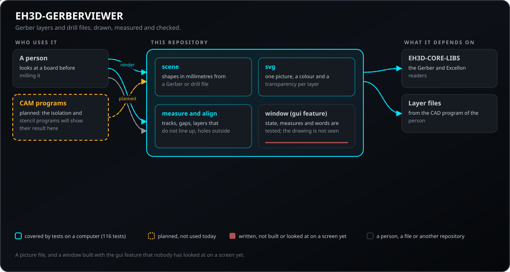
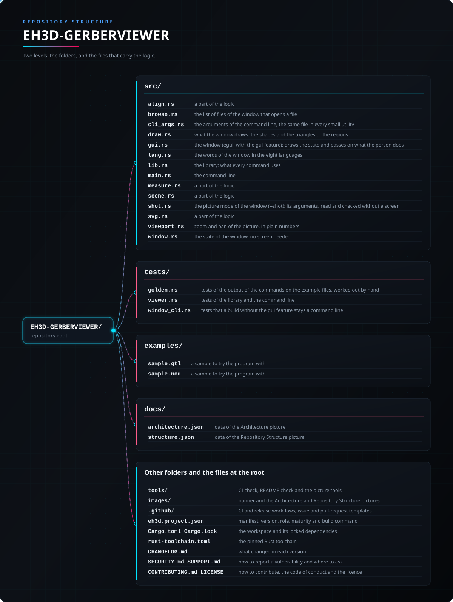

<p align="center">
  
</p>

#  EH3D-GERBERVIEWER
<p align="center"><a href="README.md">🇺🇸 English</a> | <a href="README_spa.md">🇪🇸 Español</a> | <a href="README_fra.md">🇫🇷 Français</a> | <a href="README_ita.md">🇮🇹 Italiano</a> | <a href="README_deu.md">🇩🇪 Deutsch</a> | <a href="README_zho.md">🇨🇳 中文</a> | 🇯🇵 <b>日本語</b> | <a href="README_por.md">🇵🇹 Português</a></p>

### Gerber レイヤーとドリル ファイルの軽量ビューアー：画像、測定、位置合わせの確認

<p align="center">
  
  
  
  
  
</p>

---

**正直さの確認 - 現在実際に動くもの：** Rust ライブラリとコマンドライン プログラム（`eh3d-gerberview`）で、コンピューター上で実行される 106 件のテストがあります：Gerber レイヤーとドリル ファイルを SVG 画像に描き、パターン幅と間隔を測り、レイヤーの位置が合っているか確認します。ウィンドウ（`--features gui` でビルド）でレイヤーを重ねて拡大縮小と移動つきで表示できますが、画面ではまだ確認しておらず、機械では試しておらず、実際のファイルの集まりでも確認していません。

---

> **安全とセキュリティの状況：** このプログラムは機械を制御せず、安全システムでもありません。出力は、機械で何かを実行する前に人が確認する必要があります。ここにあるものは実機で動かしたことがありません。


## 📋 ひと目で

| | |
|---|---|
| バージョン | `0.0.6` |
| 成熟度 | 足場 |
| テスト | 106 |
| 技術スタック | Rust |
| 実機での動作 | 未試験：ここにあるものは機械で動かしたことがありません |

**移動先：** [概要](#-概要) · [アーキテクチャ](#-アーキテクチャ) · [クイックスタート](#-クイックスタート) · [テスト](#-テスト) · [構成](#-リポジトリの構成) · [関連](#-関連プロジェクト)

## 🚦 プロジェクトの状況

各行はこのリポジトリの一部分で、信号は今日どこまで進んでいるかを示します。計画ではなく、リポジトリが示せるもの（テスト、ビルド、実行）に基づいて書かれています。

🟢 完了・検証済み · 🟡 動作する（既知の制限あり） · 🟠 一部のみ、または未検証 · 🔴 未実装または動作しない

| 領域 | 状態 | ここでの意味 |
|---|---|---|
| コア | 🟡 | Gerber レイヤーとドリル ファイルを SVG 画像に描き、パターン幅と間隔を測り、レイヤーの位置が合っているか確認します。コンピューター上で通常入力と破損入力でテスト済み。実際のファイルの集まりでは未確認。 |
| コマンドライン | 🟡 | `eh3d-gerberview` はライブラリと同じ関数を実行して結果を表示します。エラーはメッセージと 0 以外の終了コードで返ります。 |
| テスト | 🟡 | 106 件のテストが通ります（`cargo test`）。通常ケース、境界ケース、破損入力を含みます。 |
| セキュリティ | 🟡 | 安全な Rust のみ（`forbid(unsafe_code)`）。受け取ったファイルでパニックせず、不正な値は理由付きのエラーになります。独立したレビューはありません。 |
| ウィンドウ | 🟠 | 作成済み（egui、`--features gui`）：複数のレイヤーとドリルファイルの追加またはドロップ、各レイヤーの表示と非表示、拡大縮小と移動、測定、位置合わせの確認、SVG 画像の書き出し。ロジックはテスト済みですが、まだビルドも画面での確認もしていません。 |
| 実機 | 🔴 | 未試験：ここにあるものは機械で実行したことがありません。 |
| ドキュメント | 🟡 | 8 言語の README、変更履歴、`docs/` から描いた 2 枚の図。 |

## 🎯 概要

* **図形**（`src/scene.rs`，`eh3d-geometry`）：パッド（円・長方形・長円）、幅付きの配線、領域、円弧を、ファイルの単位に関係なくミリメートルで扱います。ドリル ファイルの穴は工具径の円板になります。正確に描けないもの（クリア極性、ステップ＆リピート、マクロ）は 1 回ずつ一覧に出します。 長方形のペンで描かれたトラックは、丸い端の線ではなく、掃引された長方形（線分とペンのポリゴン）として描かれます。
* **画像**（`src/svg.rs`）：各レイヤーは独自の色（ファイル拡張子から）と透明度を持つグループで、基板を上から見た向き（y が上）。レイヤーが空なら小さな空の画像になり、名前と色はエスケープして検査します。
* **測定と確認**（`src/measure.rs`、`src/align.rs`）：最も細い配線、2 つのパッド間の距離、丸いパッドと配線の最小間隔（端から端、接していれば 0）、中心がずれたレイヤー、銅箔の外にある穴。比較するレイヤーがないとき、`check` は「揃っている」と言わずにその旨を伝えます。`measure` はレイヤーをちょうど 1 つ受け取ります。 すべてのコマンドは `--max-bytes N`（これより大きなファイルは読み込む前に拒否され、メッセージはシステムの言語で表示）と `--arc-tolerance MM`（円弧をどれだけ忠実にたどるか）も受け付けます。

## 🧩 EH3D での役割

EH3D-GERBERVIEWER は EH3D Fabrication Suite のプログラムの一つです。ライブラリとコマンドラインとして動作し、`--features gui` でビルドすると、スイートの他のプログラムと共通の外観のウィンドウとしても動作します。単純なファイルを読み書きするため、単独でも他のプログラムの間でも使えます。

## 🏛️ アーキテクチャ

<p align="center">
  
</p>


このリポジトリの各部分の関係：誰が使い、何を持ち、何に依存するか。図は `docs/architecture.json` から描かれ、コードと照合されます。

## ✨ 機能

* **ライブラリとコマンドライン：** `eh3d-gerberview` の各コマンドはライブラリの関数なので、スイートの他のプログラムがプロセスを起動せずに呼び出せます。
* **破損入力のテスト：** 空のファイル、ゴミデータ、巨大な数値、途中で切れたファイルも与え、どれもパニックしてはいけません。
* **推測しない：** 意味のない値は、どの値かと理由を示すエラーになり、見かけだけ正しい結果にはなりません。
* **unsafe コードなし：** ライブラリとプログラムに `#![forbid(unsafe_code)]`。
* **ドリルファイルはヘッダーで判別し、レイヤーは公開ファイルで検証します：** `M48` で始まるファイルは拡張子（`.txt`、`.nc`、なし）に関わらずドリルファイルとして読み、`check` はレイヤーの中心だけを比べるので銅箔より大きいソルダーマスクも揃っているとみなし、テストでは読み取り器の公開 Gerber ファイルを要約が期待する範囲内に描画します。

## 🔒 セキュリティと安全

| 脅威 | 対策 |
|---|---|
| 破損・途中切れ・空のファイル | パニックなし：テストは有効な入力をあらゆる位置で切り、ゴミデータも与えます |
| 意味のない数値（負、無限、極端に大きい） | 値を示すエラーで拒否され、もっともらしい値に丸められることはありません |
| 安全でないメモリ使用 | `forbid(unsafe_code)` の安全な Rust のみ |

**防御していないこと：** エラーなく作られた結果は、検証された結果ではありません。ここには機械の限界を知るものはなく、プログラムは独立したレビューを受けていません。脆弱性は非公開で報告してください（[SECURITY.md](SECURITY.md) 参照）。

## 🔌 インターフェース

ライブラリは `eh3d_gerberviewer`（`use eh3d_gerberviewer::...`）、コマンドラインは `eh3d-gerberview` です。コマンドは次のとおりで、結果は標準出力に表示され、エラーは標準エラー出力に 0 以外の終了コードで報告されます。ネットワークアクセスはありません。

```text
EH3D-GERBERVIEWER/
├── src/
│   ├── align.rs                                 ロジックの一部
│   ├── browse.rs                                ファイルを開くウィンドウのファイル一覧
│   ├── draw.rs                                  ウィンドウが描くもの：図形と領域の三角形
│   ├── gui.rs                                   ウィンドウ（egui、gui 機能）：状態を描き、操作を伝える
│   ├── lang.rs                                  ウィンドウの文言（8言語）
│   ├── lib.rs                                   ライブラリ：各コマンドが使うもの
│   ├── main.rs                                  コマンドライン
│   ├── measure.rs                               ロジックの一部
│   ├── scene.rs                                 ロジックの一部
│   ├── svg.rs                                   ロジックの一部
│   ├── viewport.rs                              画像の拡大縮小と移動（単純な数値）
│   └── window.rs                                画面なしのウィンドウの状態：レイヤー、パラメーター、測定、確認、書き出し、ステータス
├── tests/
│   ├── viewer.rs                                ライブラリとコマンドラインのテスト
│   └── window_cli.rs                            gui 機能なしのビルドがコマンドラインのままであることのテスト
├── examples/
│   ├── sample.gtl                               試すためのサンプル
│   └── sample.ncd                               試すためのサンプル
├── docs/
│   ├── architecture.json                        アーキテクチャ図のデータ
│   └── structure.json                           構成図のデータ
├── tools/                                       CI と README のチェック、図のツール
├── images/                                      バナーとアーキテクチャ・リポジトリ構成の図
├── .github/                                     CI とリリースのワークフロー、Issue と PR のテンプレート
├── eh3d.project.json                            マニフェスト：バージョン、役割、成熟度、ビルドコマンド
├── Cargo.toml Cargo.lock                        ワークスペースと固定された依存関係
├── rust-toolchain.toml                          固定されたRustツールチェーン
├── CHANGELOG.md                                 各バージョンの変更点
├── SECURITY.md SUPPORT.md                       脆弱性の報告方法と問い合わせ先
└── CONTRIBUTING.md CODE_OF_CONDUCT.md LICENSE   貢献方法、行動規範、ライセンス
```

## ⚙️ 設定

設定ファイルはまだありません。選択は（インターフェースを参照）コマンドラインの引数で渡し、各既定値はコマンドのヘルプ（`eh3d-gerberview help`）に書かれています。固定の上限はコード内の名前付き定数で、テストで確認されています。

## 🚀 クイックスタート

安定版の Rust ツールチェーン（1.75 以降）が必要です。

```bash
cargo build --release
cargo test
cargo run --release -- info examples/sample.gtl examples/sample.ncd
cargo run --release --features gui   # the window
```

## 🧪 テスト

テストは 106 件あります（`cargo test`、CI では Windows と Linux で実行）。通常ケース、境界ケース、破損入力を確認し、空のファイル、ゴミデータ、途中で切れたファイルでもパニックしません。CI は `cargo fmt --check`、警告をエラーにした `cargo clippy`、`python -I tools/ci_validate.py` も実行します。

## 🏗️ ビルドとリリース

バージョンは `Cargo.toml` と `eh3d.project.json` にあり、各バージョンは [CHANGELOG.md](CHANGELOG.md) に項目があります。`build.bat` / `build.sh` でビルド、`test.bat` / `test.sh` でテスト、`run.bat` / `run.sh` でサンプル実行します。リリースは GitHub で公開されます。

### ダウンロード

各バージョンには、Windows（64 ビットと 32 ビット）、Linux（64 ビット）、macOS（Apple silicon と Intel）向けの、ウィンドウ付きのプログラムが `<名前>-<バージョン>-<システム>.zip`（Windows）または `.tar.gz` として含まれ、プログラム、ライセンス、README、アイコン、サンプルが入っています。ファイルは GitHub Actions でビルドされ、`SHA256SUMS` に記載され、EH3D の鍵で署名されています。ダウンロードを確認するには、隣にある `.sha256` ファイルとハッシュを比較し（`sha256sum -c`）、隣にある `.sig` ファイルで署名を確認します（`ssh-keygen -Y verify`）。

## 📂 リポジトリの構成

<p align="center">
  
</p>

<details>
<summary>ツリーのテキスト版</summary>

```text
EH3D-GERBERVIEWER/
├── src/
│   ├── align.rs                                 ロジックの一部
│   ├── browse.rs                                ファイルを開くウィンドウのファイル一覧
│   ├── draw.rs                                  ウィンドウが描くもの：図形と領域の三角形
│   ├── gui.rs                                   ウィンドウ（egui、gui 機能）：状態を描き、操作を伝える
│   ├── lang.rs                                  ウィンドウの文言（8言語）
│   ├── lib.rs                                   ライブラリ：各コマンドが使うもの
│   ├── main.rs                                  コマンドライン
│   ├── measure.rs                               ロジックの一部
│   ├── scene.rs                                 ロジックの一部
│   ├── svg.rs                                   ロジックの一部
│   ├── viewport.rs                              画像の拡大縮小と移動（単純な数値）
│   └── window.rs                                画面なしのウィンドウの状態：レイヤー、パラメーター、測定、確認、書き出し、ステータス
├── tests/
│   ├── viewer.rs                                ライブラリとコマンドラインのテスト
│   └── window_cli.rs                            gui 機能なしのビルドがコマンドラインのままであることのテスト
├── examples/
│   ├── sample.gtl                               試すためのサンプル
│   └── sample.ncd                               試すためのサンプル
├── docs/
│   ├── architecture.json                        アーキテクチャ図のデータ
│   └── structure.json                           構成図のデータ
├── tools/                                       CI と README のチェック、図のツール
├── images/                                      バナーとアーキテクチャ・リポジトリ構成の図
├── .github/                                     CI とリリースのワークフロー、Issue と PR のテンプレート
├── eh3d.project.json                            マニフェスト：バージョン、役割、成熟度、ビルドコマンド
├── Cargo.toml Cargo.lock                        ワークスペースと固定された依存関係
├── rust-toolchain.toml                          固定されたRustツールチェーン
├── CHANGELOG.md                                 各バージョンの変更点
├── SECURITY.md SUPPORT.md                       脆弱性の報告方法と問い合わせ先
└── CONTRIBUTING.md CODE_OF_CONDUCT.md LICENSE   貢献方法、行動規範、ライセンス
```

</details>

## 🗺️ ロードマップと既知の制限

**現時点で分かっている制限**

* ウィンドウは画面でまだ確認していません。
* 機械でも実際のファイルの集まりでも試しておらず、独立したレビューも受けていません。
* 間隔の測定では長方形パッドや領域を比較せず、ウィンドウでは同じレイヤーの重なる図形を重ねて描くため、重なる部分では不透明度が加算されます。

**次のステップ**

* ウィンドウを画面で確認して仕上げる：画像をクリックして測定し、測定が挙げるパッドとトラックを強調表示する。
* 各レイヤーを不透明度ごと一括で描き、同じレイヤーの図形が重なる部分で不透明度が加算されないようにする。
* 実際のファイルとスイートの他のプログラムで試す。

## 🌍 言語

README とテキストは、英語、スペイン語、フランス語、イタリア語、ドイツ語、中国語、日本語、ヨーロッパポルトガル語で提供されています。

## 🔗 関連プロジェクト

* [EH3D-CORE-LIBS](https://github.com/JuanenRac/EH3D-CORE-LIBS): Gerber、Excellon、G コードのリーダー
* [EH3D-COMMON](https://github.com/JuanenRac/EH3D-COMMON): プロジェクト コンテナーとスイート共通の型
* [EH3D-SUITE-LAUNCHER](https://github.com/JuanenRac/EH3D-SUITE-LAUNCHER): スイートのプログラムを見つけて起動するハブ
* [EH3D-ISOCAM](https://github.com/JuanenRac/EH3D-ISOCAM): 銅箔の絶縁ミリング
* [EH3D-STENCILCAM](https://github.com/JuanenRac/EH3D-STENCILCAM): はんだペースト用ステンシル

## 📚 ドキュメント

* [変更履歴](CHANGELOG.md)
* [アーキテクチャと構成のデータ](docs/architecture.json)：2 枚の図を描くためのデータ。

## 🤝 コントリビュートとコミュニティ

* プルリクエストの前に `cargo fmt --check`、`cargo clippy --all-targets -- -D warnings`、`cargo test`、`python -I tools/ci_validate.py` を実行し、すべて通してください。[CONTRIBUTING.md](CONTRIBUTING.md) と[行動規範](CODE_OF_CONDUCT.md)を参照。
* README は 8 言語あります。文章の変更は 8 ファイルすべてで行い、2 枚の図は `tools/make_architecture.py` と `tools/make_structure.py` が `docs/architecture.json` と `docs/structure.json` から描きます。
* 脆弱性は非公開で報告してください：[SECURITY.md](SECURITY.md)。質問・提案・報告：electrohobby3d@gmail.com（[SUPPORT.md](SUPPORT.md)）。

## 👤 作者

**JuanenRac (Electro Hobby 3D)** · electrohobby3d@gmail.com

## 📜 ライセンス

ソフトウェア：GPL-3.0-or-later。[LICENSE](LICENSE) を参照。スイートのハードウェア設計には CERN OHL-S を使います。
