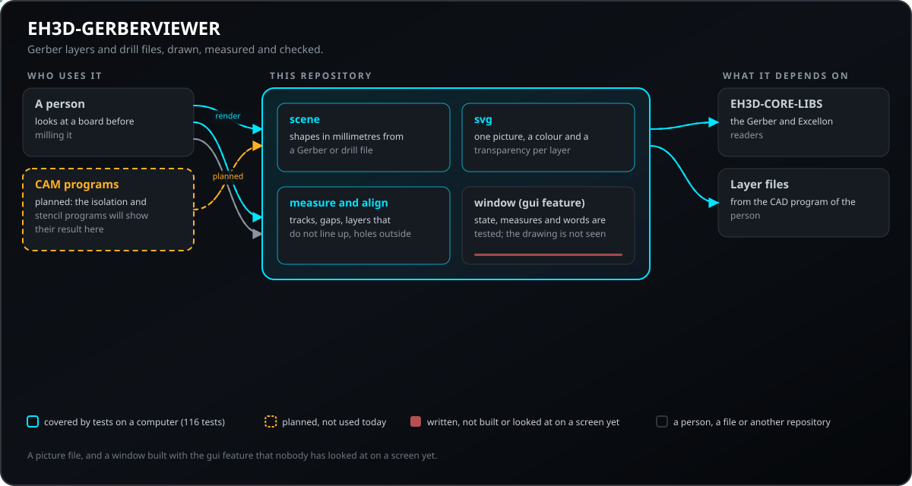
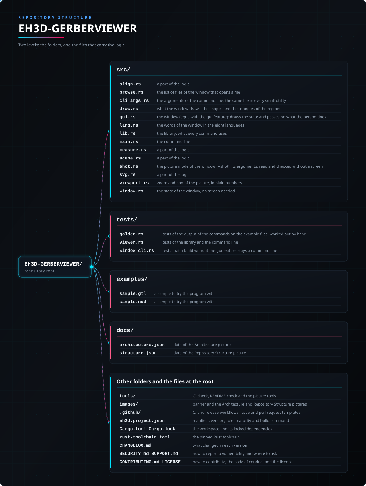

<p align="center">
  
</p>

#  EH3D-GERBERVIEWER
<p align="center"><a href="README.md">🇺🇸 English</a> | <a href="README_spa.md">🇪🇸 Español</a> | <a href="README_fra.md">🇫🇷 Français</a> | <a href="README_ita.md">🇮🇹 Italiano</a> | <a href="README_deu.md">🇩🇪 Deutsch</a> | <a href="README_zho.md">🇨🇳 中文</a> | <a href="README_jpn.md">🇯🇵 日本語</a> | 🇵🇹 <b>Português</b></p>

### Um visualizador leve de camadas Gerber e ficheiros de furação: imagens, medições e verificação de alinhamento

<p align="center">
  
  
  
  
  
</p>

---

**Verificação de honestidade - o que funciona hoje:** uma biblioteca Rust e um programa de linha de comandos (`eh3d-gerberview`) com 106 testes que correm num computador: desenha camadas Gerber e ficheiros de furação como imagem SVG, mede pistas e folgas e verifica se as camadas se alinham. Tem uma janela (compilada com `--features gui`) que mostra as camadas umas sobre as outras com zoom e deslocamento, mas que ainda não foi vista num ecrã; não foi experimentado numa máquina e não foi verificado com uma coleção de ficheiros reais.

---

> **Estado de segurança:** este programa não controla nenhuma máquina e não é um sistema de segurança. O que produz deve ser verificado por uma pessoa antes de se executar algo numa máquina; nada disto correu em hardware real.


## 📋 Num relance

| | |
|---|---|
| Versão | `0.0.6` |
| Maturidade | Estrutura inicial |
| Testes | 106 |
| Tecnologias | Rust |
| Em hardware real | Não experimentado: nada disto correu numa máquina |

**Ir para:** [Visão geral](#-visão-geral) · [Arquitetura](#-arquitetura) · [Início rápido](#-início-rápido) · [Testes](#-testes) · [Estrutura](#-estrutura-do-repositório) · [Relacionados](#-projetos-relacionados)

## 🚦 Estado do projeto

Cada linha é uma parte deste repositório e a luz diz até onde chega hoje. É escrita com o que o repositório consegue demonstrar (testes, compilações, execuções), não com o que está previsto.

🟢 Feito e verificado · 🟡 Funciona, com limites conhecidos · 🟠 Feito a meio ou ainda por verificar · 🔴 Por fazer ou a não funcionar

| Área | Estado | O que significa aqui |
|---|---|---|
| Núcleo | 🟡 | desenha camadas Gerber e ficheiros de furação como imagem SVG, mede pistas e folgas e verifica se as camadas se alinham; testado num computador com entradas normais e danificadas, não com uma coleção de ficheiros reais. |
| Linha de comandos | 🟡 | `eh3d-gerberview` executa as mesmas funções da biblioteca e imprime o resultado; cada erro volta como mensagem e código de saída diferente de zero. |
| Testes | 🟡 | 106 testes passam (`cargo test`), com casos normais, casos-limite e entradas danificadas. |
| Segurança | 🟡 | Rust seguro e simples (`forbid(unsafe_code)`): nada entra em pânico com os ficheiros recebidos e um valor mau é um erro com o seu motivo; sem revisão independente. |
| Janela | 🟠 | Escrita (egui, `--features gui`): adicionar ou largar várias camadas e ficheiros de furação, mostrar ou ocultar cada uma, zoom e deslocamento, medir, verificar o alinhamento, exportar a imagem em SVG; a sua lógica está testada, mas ainda não foi compilada nem vista num ecrã. |
| Hardware real | 🔴 | Não experimentado: nada disto foi executado numa máquina. |
| Documentação | 🟡 | README em oito idiomas, o registo de alterações e as duas imagens desenhadas a partir de `docs/`. |

## 🎯 Visão geral

* **As formas** (`src/scene.rs`, `eh3d-geometry`): pads (redondos, retangulares, ovais), pistas com a sua largura, regiões e arcos, tudo em milímetros sejam quais forem as unidades do ficheiro; os furos de um ficheiro de furação são discos do diâmetro da sua ferramenta. O que não se consegue desenhar com exatidão (polaridade clara, repetição, macros) é listado, uma vez cada. Uma pista traçada com uma abertura retangular é o retângulo varrido (o segmento e a abertura, um polígono), não uma linha de pontas redondas.
* **A imagem** (`src/svg.rs`): cada camada é um grupo com a sua cor (pela extensão do ficheiro) e transparência, a placa vista de cima com y para cima; uma lista vazia de camadas dá uma imagem pequena vazia, e os nomes e cores são escapados e verificados.
* **Medições e verificações** (`src/measure.rs`, `src/align.rs`): a pista mais estreita, a distância entre dois pads, a folga mínima entre pads redondos e pistas (de borda a borda, 0 onde se tocam), as camadas com o centro deslocado e os furos que não caem dentro do cobre. O `check` diz quando não há camadas para comparar em vez de afirmar que coincidem, e o `measure` aceita exatamente uma camada. Todos os comandos aceitam ainda `--max-bytes N` (um ficheiro maior é recusado antes de ser lido, com a mensagem na língua do sistema) e `--arc-tolerance MM` (o rigor dos arcos).

## 🧩 Papel no EH3D

EH3D-GERBERVIEWER é um programa da EH3D Fabrication Suite. Funciona como biblioteca e linha de comandos e, compilado com `--features gui`, como janela com o aspeto que os outros programas da suíte partilham. Lê e escreve ficheiros simples, por isso pode ser usado sozinho ou entre os outros programas.

## 🏛️ Arquitetura

<p align="center">
  
</p>


Como as partes deste repositório se encaixam: quem o usa, o que contém e de que depende. A imagem é desenhada a partir de `docs/architecture.json` e verificada com o código.

## ✨ Funcionalidades

* **Biblioteca e linha de comandos:** cada comando de `eh3d-gerberview` é uma função da biblioteca, por isso outro programa da suíte pode chamá-la sem lançar um processo.
* **Testes com entradas danificadas:** os testes também dão ficheiros vazios, lixo, números enormes e ficheiros cortados, e nenhum pode entrar em pânico.
* **Sem adivinhar:** um valor sem sentido é um erro que diz qual e porquê, nunca um resultado que apenas parece certo.
* **Sem código unsafe:** `#![forbid(unsafe_code)]` na biblioteca e no programa.
* **Um ficheiro de furação reconhece-se pelo cabeçalho, e as camadas verificam-se com ficheiros públicos:** um ficheiro que começa por `M48` é lido como de furação qualquer que seja a extensão (`.txt`, `.nc`, nenhuma), `check` compara só os centros das camadas (assim uma máscara de soldadura maior do que o cobre alinha) e um teste desenha os ficheiros Gerber públicos dos leitores dentro da caixa que os seus resumos esperam.

## 🔒 Segurança e proteção

| Ameaça | Defesa |
|---|---|
| Um ficheiro danificado, cortado ou vazio | sem pânico: os testes cortam uma entrada válida em cada posição e dão lixo |
| Um número sem sentido (negativo, não finito, absurdamente grande) | recusado com um erro que nomeia o valor; nada é arredondado para algo plausível |
| Uso inseguro de memória | Rust seguro e simples com `forbid(unsafe_code)` |

**O que não é defendido:** um resultado produzido sem erros não é um resultado verificado. Nada aqui conhece os limites de uma máquina e o programa não teve revisão independente. Comunique uma vulnerabilidade em privado (ver [SECURITY.md](SECURITY.md)).

## 🔌 Interfaces

A biblioteca é `eh3d_gerberviewer` (`use eh3d_gerberviewer::...`); a linha de comandos é `eh3d-gerberview`. Os comandos são estes; cada um imprime o resultado na saída padrão e comunica um erro na saída de erros com um código de saída diferente de zero. Não há acesso à rede.

```text
EH3D-GERBERVIEWER/
├── src/
│   ├── align.rs                                 uma parte da lógica
│   ├── browse.rs                                a lista de ficheiros da janela que abre um ficheiro
│   ├── draw.rs                                  o que a janela desenha: as formas e os triângulos das regiões
│   ├── gui.rs                                   a janela (egui, com a funcionalidade gui): desenha o estado e transmite o que a pessoa faz
│   ├── lang.rs                                  as palavras da janela nos oito idiomas
│   ├── lib.rs                                   a biblioteca: o que cada comando usa
│   ├── main.rs                                  a linha de comandos
│   ├── measure.rs                               uma parte da lógica
│   ├── scene.rs                                 uma parte da lógica
│   ├── svg.rs                                   uma parte da lógica
│   ├── viewport.rs                              zoom e deslocamento da imagem, em números simples
│   └── window.rs                                o estado da janela sem ecrã: camadas, parâmetros, medidas, verificações, exportação e estado
├── tests/
│   ├── viewer.rs                                testes da biblioteca e da linha de comandos
│   └── window_cli.rs                            testes de que uma compilação sem a funcionalidade gui continua a ser só linha de comandos
├── examples/
│   ├── sample.gtl                               um exemplo para experimentar o programa
│   └── sample.ncd                               um exemplo para experimentar o programa
├── docs/
│   ├── architecture.json                        dados da imagem de Arquitetura
│   └── structure.json                           dados da imagem de Estrutura
├── tools/                                       verificação da CI e do README e ferramentas de imagens
├── images/                                      banner e as imagens de Arquitetura e Estrutura do repositório
├── .github/                                     fluxos de CI e de publicação, modelos de issues e pull requests
├── eh3d.project.json                            manifesto: versão, papel, maturidade e comando de compilação
├── Cargo.toml Cargo.lock                        o workspace e as suas dependências fixadas
├── rust-toolchain.toml                          a toolchain de Rust fixada
├── CHANGELOG.md                                 o que mudou em cada versão
├── SECURITY.md SUPPORT.md                       como comunicar uma vulnerabilidade e onde perguntar
└── CONTRIBUTING.md CODE_OF_CONDUCT.md LICENSE   como contribuir, o código de conduta e a licença
```

## ⚙️ Configuração

Ainda não há ficheiro de configuração: o que a pessoa escolhe é dado como argumentos da linha de comandos (ver Interfaces) e cada valor por omissão está escrito na ajuda do comando (`eh3d-gerberview help`). Os limites fixos são constantes com nome no código, cobertas por testes.

## 🚀 Início rápido

Precisa de uma cadeia de ferramentas Rust estável (1.75 ou mais recente).

```bash
cargo build --release
cargo test
cargo run --release -- info examples/sample.gtl examples/sample.ncd
cargo run --release --features gui   # the window
```

## 🧪 Testes

O conjunto tem 106 testes (`cargo test`, executados em Windows e Linux no CI). Verificam os casos normais, os casos-limite e as entradas danificadas: ficheiros vazios, lixo e ficheiros cortados nunca provocam pânico. O CI executa ainda `cargo fmt --check`, `cargo clippy` com avisos como erros e `python -I tools/ci_validate.py`.

## 🏗️ Compilação e publicação

A versão está em `Cargo.toml` e em `eh3d.project.json`; cada versão tem a sua entrada em [CHANGELOG.md](CHANGELOG.md). `build.bat` / `build.sh` compilam o programa, `test.bat` / `test.sh` executam os testes e `run.bat` / `run.sh` executam-no com um exemplo. As versões são publicadas no GitHub.

### Transferências

Cada versão traz o programa com a sua janela para Windows (64 e 32 bits), Linux (64 bits) e macOS (Apple silicon e Intel), como `<nome>-<versão>-<sistema>.zip` (Windows) ou `.tar.gz` com o programa, a licença, o leia-me, o ícone e os exemplos. Os ficheiros são construídos pelo GitHub Actions, constam de `SHA256SUMS` e estão assinados com a chave da EH3D. Para verificar uma transferência, compare o seu hash com o ficheiro `.sha256` que a acompanha (`sha256sum -c`) e verifique a assinatura com o ficheiro `.sig` que a acompanha (`ssh-keygen -Y verify`).

## 📂 Estrutura do repositório

<p align="center">
  
</p>

<details>
<summary>Versão em texto da árvore</summary>

```text
EH3D-GERBERVIEWER/
├── src/
│   ├── align.rs                                 uma parte da lógica
│   ├── browse.rs                                a lista de ficheiros da janela que abre um ficheiro
│   ├── draw.rs                                  o que a janela desenha: as formas e os triângulos das regiões
│   ├── gui.rs                                   a janela (egui, com a funcionalidade gui): desenha o estado e transmite o que a pessoa faz
│   ├── lang.rs                                  as palavras da janela nos oito idiomas
│   ├── lib.rs                                   a biblioteca: o que cada comando usa
│   ├── main.rs                                  a linha de comandos
│   ├── measure.rs                               uma parte da lógica
│   ├── scene.rs                                 uma parte da lógica
│   ├── svg.rs                                   uma parte da lógica
│   ├── viewport.rs                              zoom e deslocamento da imagem, em números simples
│   └── window.rs                                o estado da janela sem ecrã: camadas, parâmetros, medidas, verificações, exportação e estado
├── tests/
│   ├── viewer.rs                                testes da biblioteca e da linha de comandos
│   └── window_cli.rs                            testes de que uma compilação sem a funcionalidade gui continua a ser só linha de comandos
├── examples/
│   ├── sample.gtl                               um exemplo para experimentar o programa
│   └── sample.ncd                               um exemplo para experimentar o programa
├── docs/
│   ├── architecture.json                        dados da imagem de Arquitetura
│   └── structure.json                           dados da imagem de Estrutura
├── tools/                                       verificação da CI e do README e ferramentas de imagens
├── images/                                      banner e as imagens de Arquitetura e Estrutura do repositório
├── .github/                                     fluxos de CI e de publicação, modelos de issues e pull requests
├── eh3d.project.json                            manifesto: versão, papel, maturidade e comando de compilação
├── Cargo.toml Cargo.lock                        o workspace e as suas dependências fixadas
├── rust-toolchain.toml                          a toolchain de Rust fixada
├── CHANGELOG.md                                 o que mudou em cada versão
├── SECURITY.md SUPPORT.md                       como comunicar uma vulnerabilidade e onde perguntar
└── CONTRIBUTING.md CODE_OF_CONDUCT.md LICENSE   como contribuir, o código de conduta e a licença
```

</details>

## 🗺️ Roteiro e limites conhecidos

**Limites conhecidos hoje**

* A janela ainda não foi vista num ecrã.
* Não foi experimentado numa máquina nem com uma coleção de ficheiros reais e não teve revisão independente.
* Não compara pads retangulares nem regiões ao medir folgas, e a janela desenha as formas sobrepostas de uma camada umas sobre as outras, pelo que a opacidade se soma onde se encontram.

**A seguir**

* Ver a janela num ecrã e completá-la: medir clicando na imagem, com os pads e pistas que uma medida nomeia realçados.
* Desenhar cada camada com a sua opacidade como um todo, para que não se some onde as formas de uma camada se sobrepõem.
* Experimentá-lo com ficheiros reais e com os outros programas da suíte.

## 🌍 Idiomas

O README e os textos existem em inglês, espanhol, francês, italiano, alemão, chinês, japonês e português europeu.

## 🔗 Projetos relacionados

* [EH3D-CORE-LIBS](https://github.com/JuanenRac/EH3D-CORE-LIBS): os leitores de Gerber, Excellon e G-code
* [EH3D-COMMON](https://github.com/JuanenRac/EH3D-COMMON): o contentor de projeto e os tipos partilhados da suíte
* [EH3D-SUITE-LAUNCHER](https://github.com/JuanenRac/EH3D-SUITE-LAUNCHER): o centro que encontra e arranca os programas da suíte
* [EH3D-ISOCAM](https://github.com/JuanenRac/EH3D-ISOCAM): a fresagem de isolamento do cobre
* [EH3D-STENCILCAM](https://github.com/JuanenRac/EH3D-STENCILCAM): os stencils de pasta de solda

## 📚 Documentação

* [Registo de alterações](CHANGELOG.md)
* [Dados de arquitetura e estrutura](docs/architecture.json): os dados a partir dos quais as duas imagens são desenhadas.

## 🤝 Contribuir e comunidade

* Antes de um pull request execute `cargo fmt --check`, `cargo clippy --all-targets -- -D warnings`, `cargo test` e `python -I tools/ci_validate.py`: tudo tem de passar. Veja [CONTRIBUTING.md](CONTRIBUTING.md) e o [código de conduta](CODE_OF_CONDUCT.md).
* O README existe em oito idiomas: uma alteração ao texto faz-se nos oito ficheiros, e as duas imagens são desenhadas a partir de `docs/architecture.json` e `docs/structure.json` por `tools/make_architecture.py` e `tools/make_structure.py`.
* Comunique uma vulnerabilidade em privado: [SECURITY.md](SECURITY.md). Perguntas, ideias e relatos: electrohobby3d@gmail.com ([SUPPORT.md](SUPPORT.md)).

## 👤 AUTOR

**JuanenRac (Electro Hobby 3D)** · electrohobby3d@gmail.com

## 📜 LICENÇA

Software: GPL-3.0-or-later. Ver [LICENSE](LICENSE). Os projetos de hardware da suite usam a CERN OHL-S.
